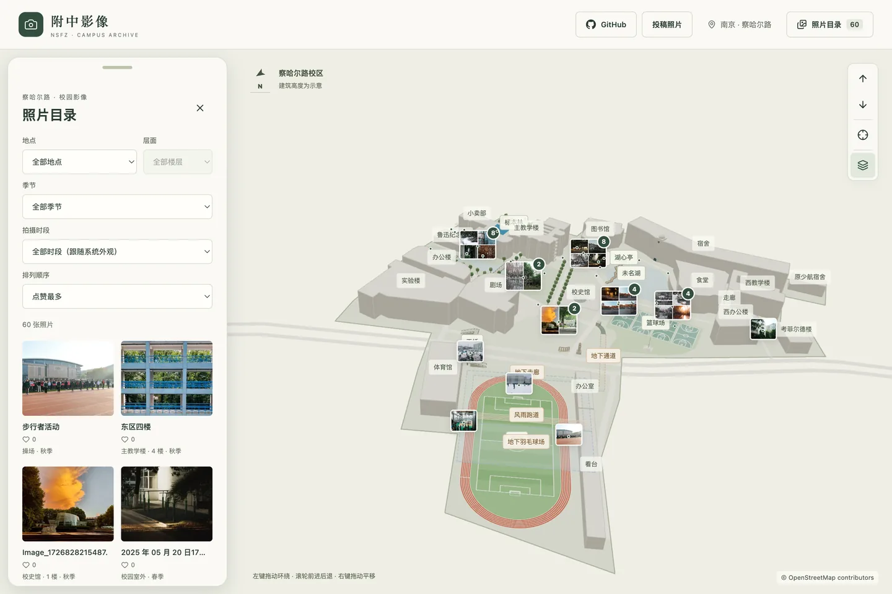
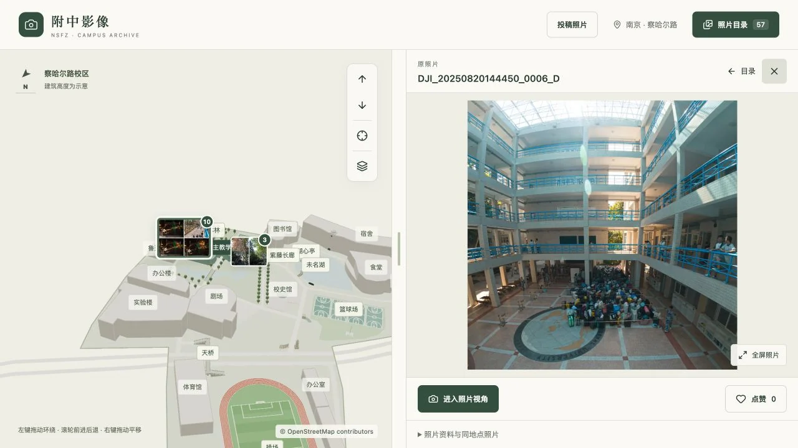
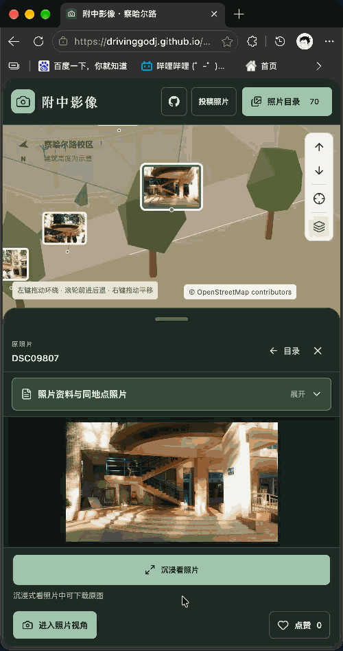
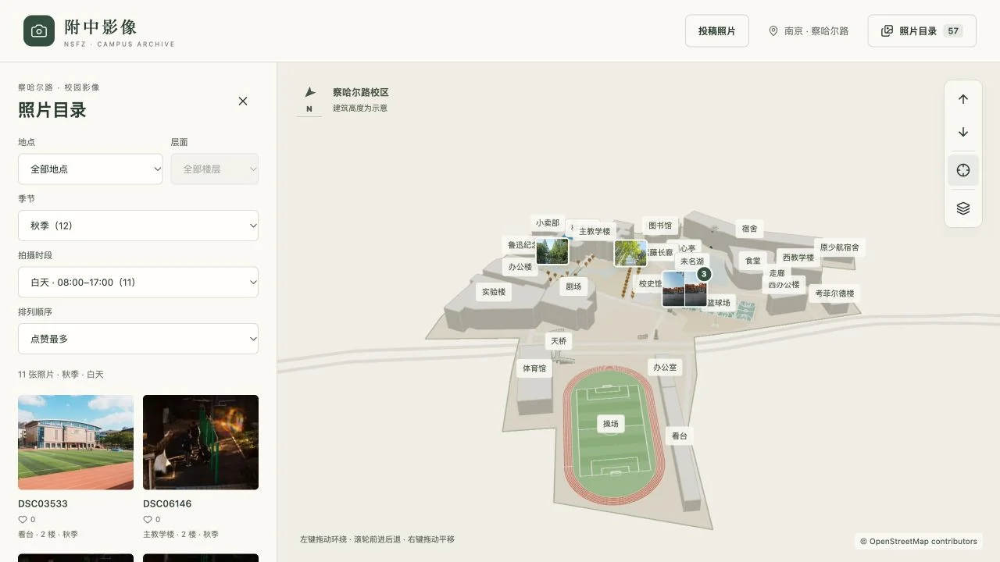

[简体中文](README.md) | **English**

# NSFZ Campus Gallery

Photos preserve moments; the map preserves their places. Put images of Nanjing Normal University Affiliated High School's Chahar Road campus back where they were taken, and revisit its buildings, lake and corridors.

[Explore the campus](https://drivinggodj.github.io/nsfz-campus-gallery/)

## Step into the place behind a photo

Browse the catalogue or select buildings and photo clusters on the map. Find images by location, floor, season and time of day: light on a staircase, autumn by the lake or a familiar classroom from another year.

Enter the photographer's viewpoint and overlay the image on the model to see how trees, walls and corridors line up.

## Watch the campus become a photograph

Open immersive viewing and the interface recedes, the model fades away and the photograph unfolds through layers of depth. Return to the map when you finish. Both landscape and portrait photographs remain fully visible.

## Rediscover the same campus across seasons

Spring, summer, autumn and winter, from morning to night, provide different ways into the archive. Selecting a photo changes the sky and lighting to its capture time while preserving the photograph's own colors.

## Add your own campus moment

Browse, like and share photo links without registering. To contribute a memory, select photos in a batch, annotate their positions and camera directions, then generate a package to submit by email.

[Open the website](https://drivinggodj.github.io/nsfz-campus-gallery/) · [Submit photos](https://drivinggodj.github.io/nsfz-campus-gallery/submit.html)

## Explore further

| Topic | Documentation |
| --- | --- |
| Map controls, downloads and submission rules | [User guide](docs/GUIDE.en.md) |
| Complete browsing experience | [Feature reference (Chinese)](docs/readme-reference.zh-CN.md) |
| Local development, review and publishing | [Maintenance (Chinese)](docs/MAINTENANCE.md) |
| Location or model corrections | [Issues](https://github.com/DrivingGodJ/nsfz-campus-gallery/issues) |

Photos belong to their rights holders; downloading does not grant republication rights. Map data © [OpenStreetMap contributors](https://www.openstreetmap.org/copyright), under ODbL. See [project and rights details](docs/GUIDE.en.md#license-and-credits).
