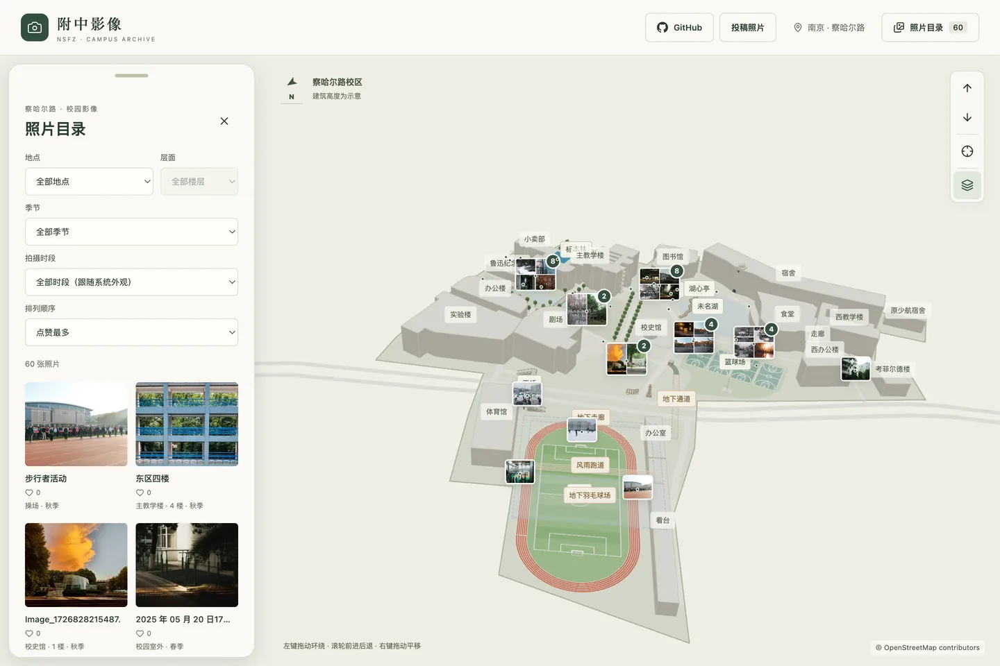
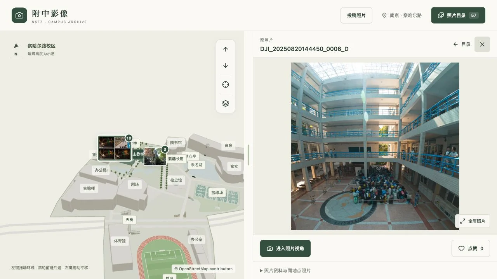

**简体中文** | [English](README.en.md)

# 附中影像

照片留住片刻，地图记住位置。围绕南师附中察哈尔路校区制作的校园照片档案，把影像放回它们的拍摄位置。

[走进校园](https://drivinggodj.github.io/nsfz-campus-gallery/) · [投稿照片](https://drivinggodj.github.io/nsfz-campus-gallery/submit.html) · [开发与维护](docs/MAINTENANCE.md)



## 功能特性

- **在三维地图中找照片**：按建筑、地点、楼层、航拍和地下空间浏览。
- **进入拍摄视角**：对照照片与模型，开启半透明叠加，或进入深度转场的沉浸浏览。
- **查看四季与晨昏**：按季节和拍摄时段筛选，地图光线随照片变化。
- **收藏校园片刻**：匿名点赞、分享照片链接和按需下载高清 JPEG。
- **共同补充档案**：批量标注照片并生成投稿包，经审核后公开。

## 快速开始

无需注册，在电脑、平板或手机打开网站即可。手机底部切换“地图 / 照片”，在“筛选”中选择季节、时段与排序；选中照片后可查看上一张、下一张或进入照片视角。

| 操作 | 键鼠 | 触屏 |
| --- | --- | --- |
| 环绕 | 左键拖动 | 单指拖动 |
| 前进/后退 | 滚轮或箭头按钮 | 双指开合或箭头按钮 |
| 平移 | 右键拖动 | 双指同向移动 |
| 回到起点 | “校园全景”按钮 | “校园全景”按钮 |

## 使用说明



照片目录默认按点赞数排序，也支持上传顺序和拍摄时间。照片资料中可以查看地点、楼层、拍摄参数、作者与版权。浏览使用缩略图和次高清图，只有点击“下载原图”才下载高清文件。该文件是控制在 5 MB 内的 JPEG，可能经过压缩，不是未经处理的相机源文件。

**投稿流程：**在投稿页选择照片，逐张标记位置、楼层和镜头方向，确认准则后生成 ZIP；再在邮件中手动添加该 ZIP，发送至 [drivinggodj@icloud.com](mailto:drivinggodj@icloud.com)。每包最多 20 张、原片合计 100 MB，单张最多 40 MB。生成投稿包不代表邮件已发送。

请只提交本人拍摄或获授权的校园景观、建筑和公共空间照片。禁止同学大头照、面部特写及侵犯隐私或肖像权益的内容；所有投稿均需审核。可附深度图，没有深度图也可投稿。

网站由 GitHub Pages 提供入口，公开图片由 Cloudflare 静态托管提供；[独立图片仓库](https://github.com/DrivingGodJ/nsfz-campus-media)保留备份。私有原片不随公开站点分发。

## 开发与验证

需要 Node.js **22.12+**，在仓库根目录运行：

```bash
npm ci
npm run dev
```

本地浏览地址为 `http://127.0.0.1:5178/`；编辑器为 `/editor.html`，投稿页为 `/submit.html`。编辑接口仅用于本地，公开构建不包含编辑器、草稿、私有原片和凭据。

```bash
npm test
npm run build
```

Mac 审核应用、NAS 同步、图片生成、点赞服务和发布步骤见维护文档；部署需要自己的服务配置与凭据。

## 文档与支持

- [完整浏览与投稿参考](docs/readme-reference.zh-CN.md)
- [维护、审核与部署](docs/MAINTENANCE.md)
- [位置、模型或功能问题反馈](https://github.com/DrivingGodJ/nsfz-campus-gallery/issues)

## 许可与致谢

地图以 OpenStreetMap 轮廓为基础，参考照片与校友标注修正；高度及部分细节为示意。地图数据 © [OpenStreetMap contributors](https://www.openstreetmap.org/copyright)，遵循 ODbL。

照片版权属于各自权利人，下载不代表获得转载许可。仓库未声明整仓软件许可证，请分别确认代码、地图和照片的适用权利。
