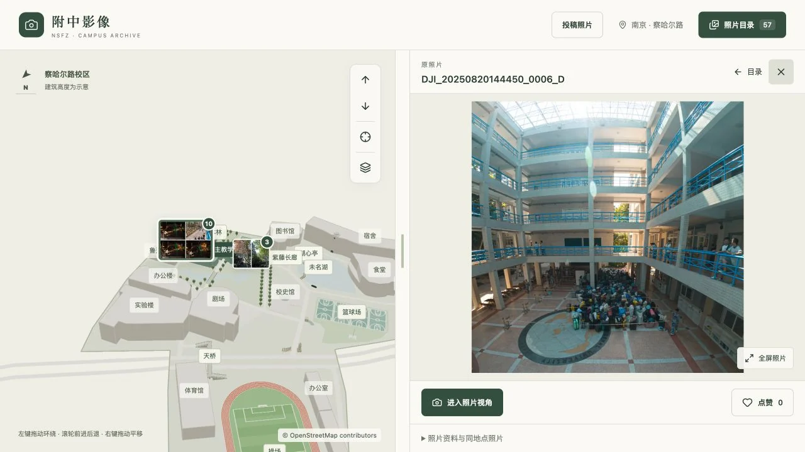

[简体中文](GUIDE.zh-CN.md) | **English**

# Usage, Configuration and Development

[Back to the project](../README.en.md)

## Quick start

Open the site on a computer, tablet or phone; no registration is required. On mobile, switch Map / Photos at the bottom and use Filters for season, time and sorting. Select a photo to navigate neighboring images or enter its viewpoint.

| Action | Mouse/keyboard | Touch |
| --- | --- | --- |
| Orbit | Left drag | One-finger drag |
| Move closer/farther | Wheel or arrow buttons | Pinch or arrow buttons |
| Pan | Right drag | Two-finger drag |
| Reset | Campus overview button | Campus overview button |

## Usage



The catalogue defaults to most-liked order; upload and capture-time sorting are also available. Photo details include location, floor, camera parameters, author and copyright. Browsing uses thumbnails and display previews; the high-resolution file is fetched only when Download original is selected. That download is a JPEG capped at 5 MB and may be compressed; it is not the untouched camera source.

**To submit:** choose photos, annotate location, floor and camera direction, accept the guidelines and generate a ZIP. Manually attach it to an email to [drivinggodj@icloud.com](mailto:drivinggodj@icloud.com). Each package supports up to 20 photos and 100 MB of originals, with a 40 MB per-photo limit. Creating a package does not send the email.

Submit only your own or authorized photos of campus scenery, buildings and public spaces. Student headshots, facial close-ups and privacy/portrait-rights violations are prohibited. All submissions require review. Depth maps are optional.

GitHub Pages hosts the website entry point, Cloudflare static hosting serves public images, and a [separate media repository](https://github.com/DrivingGodJ/nsfz-campus-media) keeps backups. Private originals are not distributed with the public site.

## Development and checks

Requires Node.js **22.12+**. From the repository root:

```bash
npm ci
npm run dev
```

Browse at `http://127.0.0.1:5178/`, use `/editor.html` for editing and `/submit.html` for submissions. Editing APIs are local only. Public builds exclude the editor, drafts, private originals and credentials.

```bash
npm test
npm run build
```

See the maintenance guide for the Mac review app, NAS synchronization, image generation, likes service and publishing. Deployment requires your own service configuration and credentials.

## Documentation and support

- [Detailed browsing and submission reference (Chinese)](../docs/readme-reference.zh-CN.md)
- [Maintenance, review and deployment (Chinese)](../docs/MAINTENANCE.md)
- [Report location, model or feature issues](https://github.com/DrivingGodJ/nsfz-campus-gallery/issues)

## License and credits

The map starts from OpenStreetMap outlines and is refined with photos and alumni annotations. Heights and some details are illustrative. Map data © [OpenStreetMap contributors](https://www.openstreetmap.org/copyright), under ODbL.

Photos belong to their respective rights holders; downloading does not grant republication rights. No repository-wide software license is declared. Check code, map and photo rights separately.
